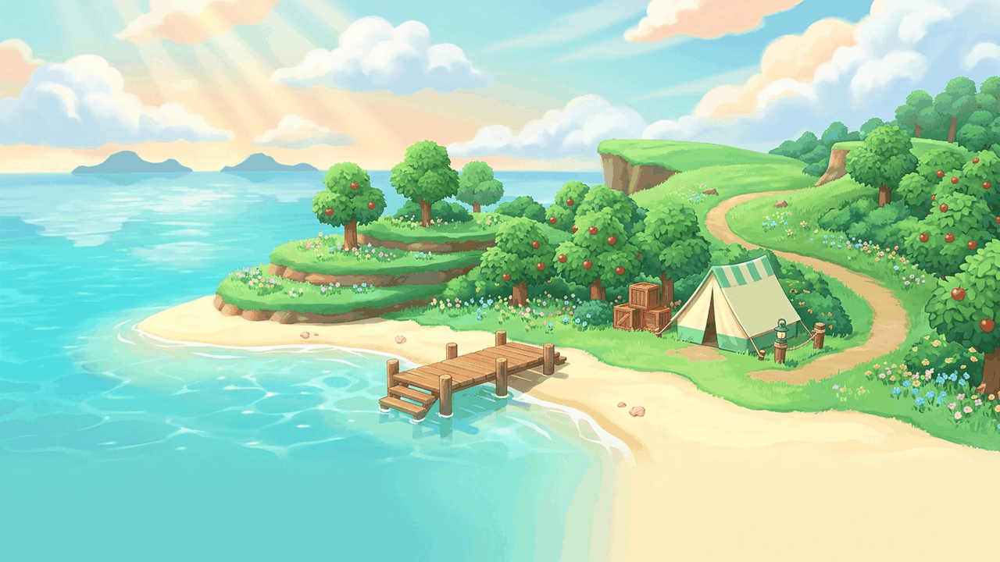

# Animal Crossing: New Horizons PC

  

  <a href="https://recomplauncher.com"><picture><source media="(prefers-color-scheme: dark)" srcset="https://recomplauncher.com/assets/press/launcher/badge-light.svg"></picture></a>

> **[Download Windows Release (v1.0.0)](https://github.com/krixsan/Animal-Crossing-New-Horizons-PC/releases/latest)** | **[Changelog](CHANGELOG.md)**  
> Standalone Windows x64 Launcher & Vulkan Runtime Player for **Animal Crossing: New Horizons** (`01006F8002326000`).  
> Includes **zero copyrighted Nintendo game files, Switch dumps, keys, or source code** — supply your own prepared game folder to play.

---

## Key Features

- **Minimalist Hero Launcher (`Animal Crossing Launcher.exe`):** Clean 16:9 island artwork home screen with **Play** and **Settings** front and center. Drop your own local `cover.png` / `hero.png` beside the launcher (or inside your build folder) to customize the cover art.
- **Direct 1-Click Launch (`Animal Crossing New Horizons (Direct).exe`):** Skips the launcher UI and boots straight into the active island build without console windows.
- **Vulkan 1.3+ Graphics & Sharpness Overhaul:** Supports 1080p TV / 720p Handheld modes, AMD FSR 1 + RCAS sharpness tuning, NVIDIA DLAA, FXAA / SSAA, 16x anisotropic filtering, and async background pipeline compilation.
- **Smooth Frame Pacing & Frame Generation:** Offloaded Vulkan presentation pacing for steady 30 FPS timing, optional native 60 FPS SpeedFix support, and AMD FSR 3 Frame Generation (`30 -> 60 FPS`).
- **Save Profiles, Mods & Add-On Manager:** Accessible inside **Settings** — create/switch/import/export island save profiles (`device_save`), manage LayeredFS RomFS mods, verify DLC add-ons (`aoc/`), and create Desktop Shortcuts.
- **Full PC & Controller Controls:** Works with Xbox, PlayStation, Switch Pro, mouse (as touchscreen), and keyboard. Press **`F1`** (or **`Plus + Minus`** on a gamepad) anytime in-game to tweak video, audio, controls, or take **`F12`** screenshots.

---

## Quick Start & Installation

### System Requirements
- **OS:** Windows 10 / Windows 11 (64-bit)
- **CPU:** x86-64 processor with **AVX2** support (Intel Core 4th Gen+ or AMD Ryzen+)
- **GPU:** **Vulkan 1.3+** capable GPU with up-to-date drivers (NVIDIA, AMD, or Intel)
- **Memory:** 8 GB RAM minimum (16 GB recommended)

### Running on Windows (Your PC or a Friend's PC)
1. Download **`Animal-Crossing-New-Horizons-PC-v1.0.0-windows-x64.zip`** from **[Releases](https://github.com/krixsan/Animal-Crossing-New-Horizons-PC/releases/latest)** and extract it to a folder (all required `SDL3.dll`, FidelityFX, DLSS, and Visual C++ Runtime DLLs are already bundled beside the executables).
2. Point the Launcher to your prepared game folder (either a `game/windows-x64/acnh_game.dll` + `romfs/` folder, or a complete `private/acnh-*` build folder copied with real files—not Windows Junction links!).
3. Open **`Animal Crossing Launcher.exe`** (or `Start Animal Crossing.bat`), adjust display settings if needed under **Settings**, and click **Play**.

> **Important note on Day-1 Saving:** Just like on Nintendo Switch, *Animal Crossing: New Horizons* does **not** create `main.dat` or auto-save during the Nook Inc. counter intro or island orientation. Complete Day 1 and **sleep on the camping cot inside your tent** so the first morning broadcast triggers your initial save inside `user/device_save/`.

---

## Controls & Shortcuts

| Action | Controller | Keyboard / Mouse |
| :--- | :--- | :--- |
| **In-Game Settings Menu** | `Plus + Minus` | `F1` |
| **Touchscreen / UI Click** | Left Stick / D-Pad + `A` | Left Mouse Click |
| **Screenshot** | `-` | `F12` |
| **Save & End (after Day 1 save)** | `Minus` (`-`) | Mapped `Minus` key |

---

## Legal Disclaimer

This is an unofficial fan compatibility project. It is **not** affiliated with, endorsed by, or sponsored by Nintendo. *Animal Crossing* is a trademark of Nintendo Co., Ltd. **No game ROMs, Switch executables, RomFS assets, decryption keys, or firmware are included or distributed in this repository or its releases.** Use only files dumped from your own legally owned console and game copy.
