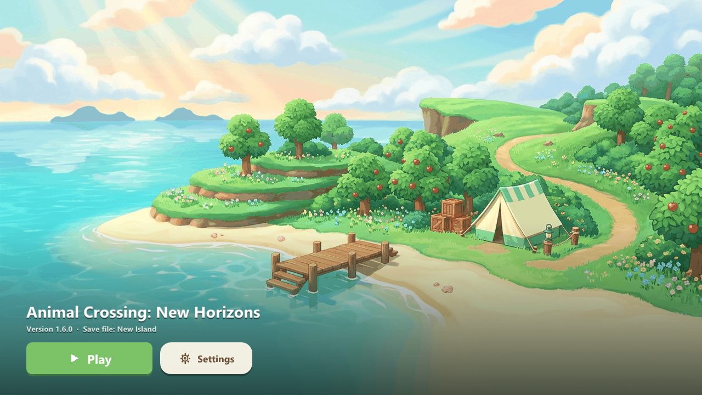

# Animal Crossing: New Horizons PC

[](https://microsoft.com/windows)
[](https://vulkan.org)
[](https://github.com/krixsan/Animal-Crossing-New-Horizons-PC/releases)
[](https://github.com/krixsan/Animal-Crossing-New-Horizons-PC/releases/tag/v1.0.0)
[](LICENSE)

<p align="center">
  
</p>

<p align="center">
  <a href="https://recomplauncher.com"><picture><source media="(prefers-color-scheme: dark)" srcset="https://recomplauncher.com/assets/press/launcher/badge-light.svg"></picture></a>
</p>

> **[Download Windows Release (v1.0.0)](https://github.com/krixsan/Animal-Crossing-New-Horizons-PC/releases/latest)** | **[Changelog](CHANGELOG.md)** | **[SHA-256 Checksums](CHECKSUMS.txt)**  
> Standalone Windows x86-64 Launcher & Native Vulkan Runtime Player for **Animal Crossing: New Horizons** (`01006F8002326000`).  
> **Zero source code and zero Nintendo game assets, Switch dumps, keys, or firmware are hosted in this repository.** Supply your own prepared game folder to play.

---

## Overview & Architecture (No Emulation)

This release provides the standalone PC frontend (**`Animal Crossing Launcher.exe`**), 1-click direct launcher (**`Animal Crossing New Horizons (Direct).exe`**), and modular Vulkan runtime player (**`acnh.exe`**, built with `NX_GAME_FROM_FOLDER=ON`).

Unlike traditional console emulators (such as Yuzu or Ryujinx), the runtime translates recompiled native x86-64 host execution directly onto Windows system APIs and **Vulkan 1.3+**:

| Subsystem | Native PC Implementation |
| :--- | :--- |
| **Graphics API** | Nintendo Switch NVN calls translated directly to **Vulkan 1.3+** (`VK_KHR_dynamic_rendering`) with offline-compiled SPIR-V shader caches and async background pipeline worker threads |
| **Frame Pacing & Presentation** | Offloaded dedicated Vulkan presenter thread paired with DXGI VBlank synchronization to maintain stable **30 FPS console frame intervals** cleanly across 60 Hz, 120 Hz, and VRR displays |
| **Upscaling & Frame Generation** | Built-in **AMD FidelityFX Super Resolution (FSR 1)** + **RCAS Sharpness**, **NVIDIA DLAA**, FXAA / SSAA, **16x Anisotropic Filtering**, and optional **AMD FSR 3.1 Optical-Flow Frame Generation (`30 -> 60 FPS`)** |
| **OS & System Services (HLE)** | Native Windows replacements for Horizon kernel threads/events, `nn::fs` (local RomFS + LayeredFS mods + device saves), `nn::hid` (SDL3 gamepads, mouse touch, keyboard text input), `nn::audio`, real-time system clock (`nn::time`), and `libvpx`/`libvorbis` movie playback |
| **Supported Game Versions** | Version `1.0.0`, `1.6.0`, `2.0.7`, `3.0.2`, and `3.0.3` (when supplied from a matching prepared build or `acnh_game.dll` folder) |

---

## Key Features

### 1. Minimalist Hero Launcher & Direct 1-Click Mode
- **`Animal Crossing Launcher.exe`:** Opens directly onto a crisp `1280x720` 16:9 island hero screen featuring **`Play`** and **`Settings`** front and center—cleanly tucking advanced tools (**Save files**, **Mods**, **Add-on content**, **Online**, **Create Desktop Shortcut**, **Change build folder**, **Rebuild**, and **Credits**) inside **Settings**.
- **Custom Cover Override (Local Only):** Place your own local `cover.png`, `hero.png`, `cover.bmp`, or `hero.bmp` next to `Animal Crossing Launcher.exe` (or inside your active build folder) to replace the built-in original island artwork locally without committing copyrighted media.
- **`Animal Crossing New Horizons (Direct).exe`:** Native WinMain executable (`156 KB`) that detects your active `launcher.ini` build (or nearby `private/acnh*` directory) and launches the game in one click with no console window.

### 2. Visual Sharpening, Aspect Safety & Performance
- **Ultrawide & Narrow Window Fix:** Under `aspect = auto`, aspect scaling is safely clamped at `min_k = 1.0`, so windows narrower than 16:9 cleanly letterbox instead of horizontally cropping the scene or displacing 16:9 cutscene bars.
- **Display & Rendering Options (`config.ini` / `F1`):** Switch between `1080p` TV Docked and `720p` Handheld modes, adjust FSR RCAS sharpness (`0–100%`), toggle `16x` anisotropic texture filtering, or enable **DLAA / FXAA / SSAA** and **FSR 3 Frame Generation**.
- **Hardware-Optimized Execution:** Uses AES-NI host acceleration for game archive decryption and pipelined GPU submits with persistent pipeline caches (`pipelines_<vendor>_<device>.bin`).

### 3. Integrated Save, Mod & Add-On Tools
- **Multi-Island Save Profile Manager:** Switch, create, import (JKSV / Checkpoint / emulator backups), or delete island save profiles stored under `user/device_save/` and `user/profiles/`.
- **LayeredFS Mod Manager:** Import `.zip` or folder RomFS mods, toggle priority order, and inspect bundled DLC add-ons (`aoc/`).

---

## Quick Start & Installation

### System Requirements
- **OS:** Windows 10 (1809+) or Windows 11 (64-bit)
- **CPU:** x86-64 processor with **AVX2** support (Intel Core 4th Gen+ or AMD Ryzen+)
- **GPU:** **Vulkan 1.3+** capable GPU with updated drivers (NVIDIA GTX 10-series / RTX, AMD Radeon RX 500+, or Intel Arc / modern Iris Xe)
- **Memory:** 8 GB RAM minimum (16 GB recommended)

### Package Contents (`v1.0.0`)
`Animal-Crossing-New-Horizons-PC-v1.0.0-windows-x64.zip` is **100% self-contained** with zero external VC++ Redistributable installer required:
- `Animal Crossing Launcher.exe` & `Animal Crossing New Horizons (Direct).exe`
- `acnh.exe` *(folder-mode Vulkan runtime player — zero game code inside)*
- `SDL3.dll`, `amd_fidelityfx_loader_vk.dll`, `amd_fidelityfx_upscaler_vk.dll`, `amd_fidelityfx_framegeneration_vk.dll`, `nvngx_dlss.dll`
- Bundled Visual C++ Runtime CRT DLLs (`vcruntime140*.dll`, `msvcp140*.dll`), `Start Animal Crossing.bat`, `README.txt`, and `licenses/`

### How to Run (On Your PC or a Friend's PC)
1. Download **`Animal-Crossing-New-Horizons-PC-v1.0.0-windows-x64.zip`** from **[Releases](https://github.com/krixsan/Animal-Crossing-New-Horizons-PC/releases/latest)** and extract it cleanly.
   - Optional checksum check in PowerShell:
     ```powershell
     Get-FileHash .\Animal-Crossing-New-Horizons-PC-v1.0.0-windows-x64.zip -Algorithm SHA256
     ```
     Expected SHA-256 (`CHECKSUMS.txt`):
     `9957e4ec62b75010641a44e5f0cae256196c20ad1b0d2e43e39d1dfa87a33adb`
2. Supply your own legally dumped and prepared game folder in either supported layout:
   - **Modular Library Layout:** folder containing `game/windows-x64/acnh_game.dll`, `exefs/`, `extract/romfs/` (or `romfs/`), and optional `aoc/`
   - **Complete Local Build Layout (`private/acnh-<version>/`):** contains `build/acnh.exe`, `analysis/`, `exefs/`, `extract/romfs/`, `spirv/`, `fonts/`, and `config.ini`
3. Open **`Animal Crossing Launcher.exe`** (or `Start Animal Crossing.bat`), select your prepared game folder when prompted, customize display settings under **Settings** if desired, and click **Play**.

> **Important Note When Copying Builds Between PCs:** On Windows, setup tools often create **Directory Junctions** for `exefs/`, `extract/romfs/`, and `aoc/`. When copying a build folder to a flash drive or another PC, make sure you copy the **actual file contents** rather than empty/broken Junction links, or the game will fail to find RomFS assets.

> **Important Note on Day-1 Saving:** Identical to the original Nintendo Switch release, *Animal Crossing: New Horizons* does **not** create `main.dat` or auto-save during the Nook Inc. counter intro, flight, or initial island orientation. Play through Day 1 until you pitch your tent and **sleep on the camping cot**—once the first morning broadcast triggers, the save icon appears and `main.dat` is written to `user/device_save/`. Afterwards, pressing **`-` (Save and End)** saves anytime normally.

---

## Controls & Shortcuts

| Action | Gamepad | Keyboard / Mouse |
| :--- | :--- | :--- |
| **In-Game Settings Overlay** | `Plus + Minus` | `F1` |
| **Touchscreen / UI Clicks** | Left Stick / D-Pad + `A` | Left Mouse Click |
| **Clean Screenshot** | `-` | `F12` (`user/screenshots/`) |
| **Save & End Session** *(after Day-1 sleep)* | `Minus` (`-`) | Mapped `Minus` key |

All keyboard bindings and button icon styles (Switch / Xbox / PlayStation confirm layout) can be remapped inside the `F1` in-game overlay.

---

## Troubleshooting & FAQ

- **Game fails to find `romfs` on another PC:** Ensure `exefs/`, `extract/romfs/`, and `aoc/` contain the full extracted files and are not dangling Windows Junction links pointing to the original PC's dump path.
- **Framerate drops or stutter on 120 Hz / 144 Hz laptops:** Ensure the laptop is plugged in, assign `acnh.exe` to your dedicated GPU (NVIDIA/AMD High Performance), keep async pipeline prewarming enabled, or toggle **AMD FSR 3 Frame Generation** in `F1` Settings.
- **Black screen or missing movie playback:** Confirm `libvpx`/`libvorbis` support is intact in the player binary and GPU Vulkan 1.3 drivers are up to date.
- **Save appears to reset after intro:** Verify whether `user/device_save/main.dat` exists; you must reach the first Day-1 tent sleep cutscene before the game creates `main.dat`.

---

## Legal Disclaimer & Licenses

This is an unofficial fan compatibility and tooling distribution portal. It is **not** affiliated with, endorsed by, or sponsored by Nintendo Co., Ltd. *Animal Crossing* is a trademark of Nintendo. **No Switch ROMs, decrypted game executables (`main`/`sdk`/`subsdk0`), `romfs/` assets, encryption keys, or console firmware are distributed in this repository or its releases.** Users must supply files obtained from their own legally owned console and game copy.

Released under the [MIT License](LICENSE). See [THIRD_PARTY_LICENSES.md](THIRD_PARTY_LICENSES.md) for bundled library notices (SDL3, Dear ImGui, AMD FidelityFX SDK, NVIDIA DLSS SDK, Mbed TLS, libvpx, libvorbis, zlib).
